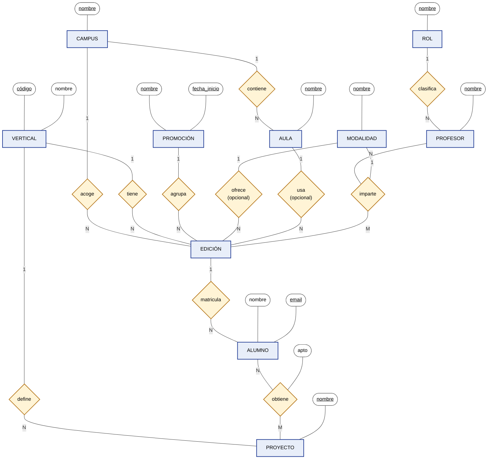

# Diagrama Entidad-Relación (notación clásica)

El mismo modelo de [er.md](er.md), dibujado como en clase: **rectángulos** para las entidades, **rombos** para las relaciones y **óvalos** para los atributos. El número junto a cada línea es la cardinalidad (1 = uno, N y M = muchos).
GitHub dibuja este diagrama al abrir el fichero. La imagen es `er-chen.png`.

## Cómo se lee
- **Subrayado** = atributo que identifica la entidad. `PROMOCIÓN` se identifica por nombre y fecha de inicio juntos.
- **Edición** es el centro: una vertical, en una promoción, en un campus. No tiene atributos propios y existe aunque no tenga alumnos o profesores.
- **obtiene** es una relación de muchos a muchos entre alumno y proyecto, y lleva el atributo `apto`.
- **imparte** une tres entidades: un profesor da docencia en una edición con una modalidad.
- Los rombos marcados *(opcional)* admiten que la edición no tenga modalidad o aula.

Estado: propuesta para revisar entre todos. Quien cambie el modelo actualiza este fichero y la imagen en el mismo commit.
