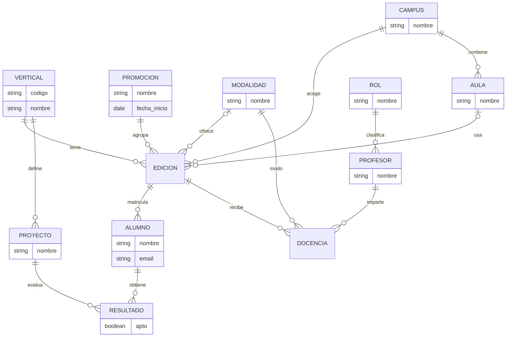

# Diagrama Entidad-Relación

Modelo conceptual: qué cosas existen y cómo se relacionan, sin claves ni columnas de enlace (eso es el modelo lógico, el paso siguiente).
GitHub dibuja este diagrama directamente al abrir el fichero. La imagen es `er.png`.

## Cómo se lee
- **Edición** es el centro: una vertical, en una promoción, en un campus. Existe aunque no tenga alumnos o profesores.
- **Alumno** pertenece a una edición. **Profesor** da docencia en una o varias ediciones.
- **Resultado** une un alumno con un proyecto y guarda si es apto. **Docencia** une un profesor con una edición y guarda la modalidad.
- **Proyecto** pertenece a una vertical: los de Data Science y los de Full Stack son distintos.
- `|o` significa "cero o uno" (modalidad y aula son opcionales en una edición) y `}o` significa "cero o muchos".

Estado: propuesta de diseño para revisar entre todos. Quien cambie el modelo actualiza este fichero y la imagen en el mismo commit.
