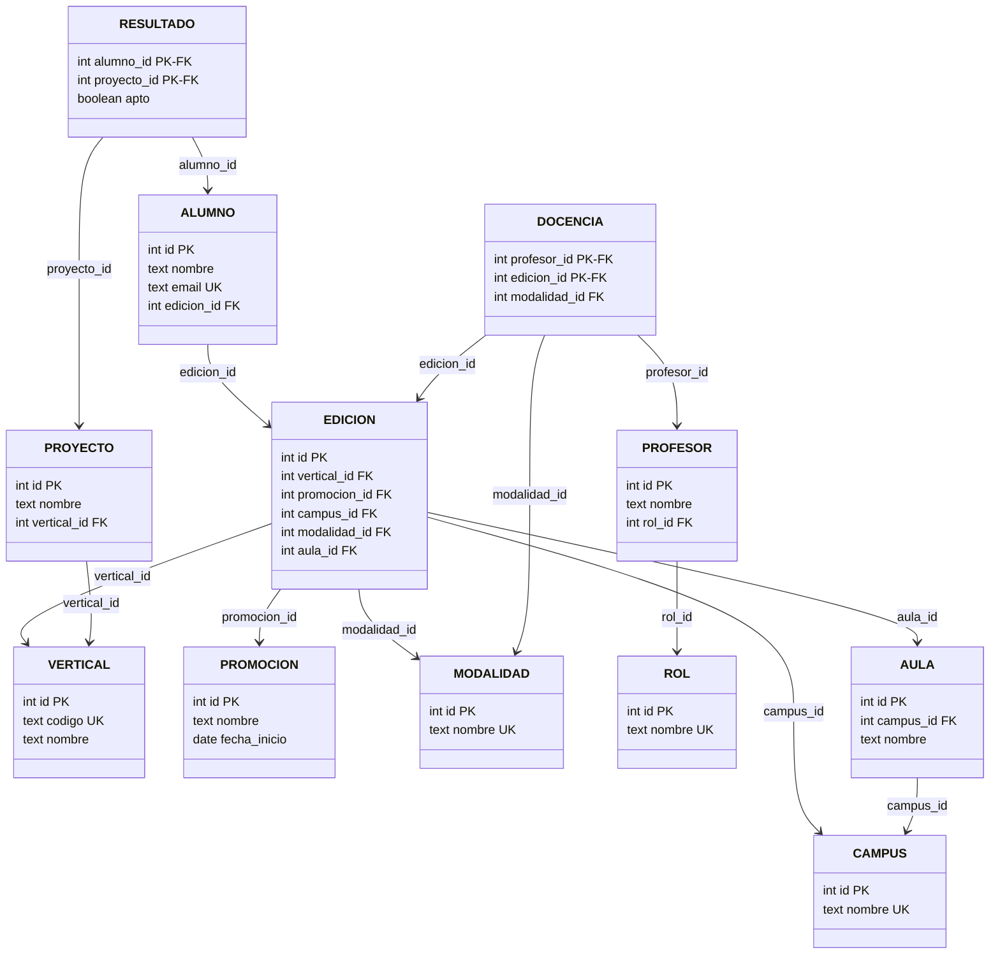

# Modelo lógico (tablas con flechas)

El mismo modelo de [logico.md](logico.md), dibujado como cajas de tabla con flechas desde la clave foránea (FK) hasta la tabla a la que apunta. **PK** = clave primaria, **UK** = valor único.
GitHub dibuja este diagrama al abrir el fichero. La imagen es `logico-tablas.png`.

## Reglas que el diagrama no dibuja
Son las mismas de [logico.md](logico.md): `edicion` es única por (vertical, promoción, campus) y admite nulo en `modalidad_id` y `aula_id`; `promocion` es única por (nombre, fecha de inicio); `proyecto` es único por (vertical, nombre); `docencia` y `resultado` tienen clave primaria compuesta.

Estado: propuesta para revisar entre todos. Quien cambie el modelo actualiza este fichero y la imagen en el mismo commit.
