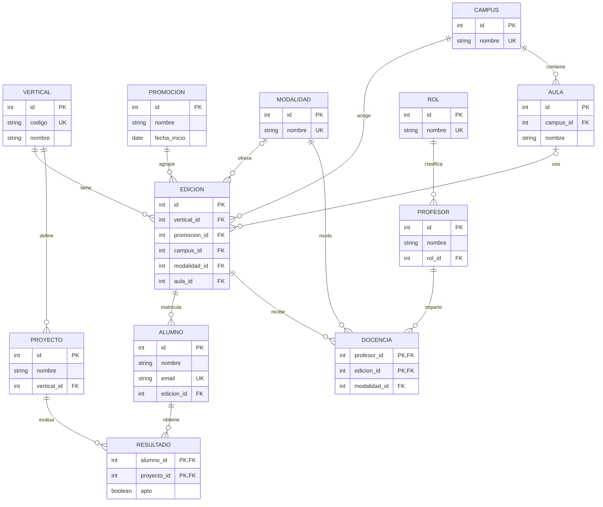

# Modelo lógico

Las tablas con sus columnas, claves primarias (PK), claves foráneas (FK) y valores únicos (UK), a partir del diagrama Entidad-Relación de [er.md](er.md).
GitHub dibuja este diagrama al abrir el fichero. La imagen es `logico.png`.

## Reglas que el diagrama no dibuja
| Tabla | Regla |
|---|---|
| `promocion` | único (nombre, fecha_inicio) |
| `edicion` | único (vertical_id, promocion_id, campus_id); `modalidad_id` y `aula_id` admiten nulo |
| `proyecto` | único (vertical_id, nombre) |
| `docencia` | clave primaria compuesta (profesor_id, edicion_id) |
| `resultado` | clave primaria compuesta (alumno_id, proyecto_id) |
| `alumno` | `edicion_id` obligatorio |
| Todas | los campos `nombre` son obligatorios |

## Qué debe salir al cargar los datos
`edicion` 6 · `alumno` 52 · `profesor` 10 · `docencia` 10 · `proyecto` 10 · `resultado` 260 · `campus` 2 · `vertical` 2 · `promocion` 2 · `modalidad` 2 · `rol` 2 · `aula` 0.

## Orden de creación y de carga
Las claves foráneas lo marcan: catálogos (`campus`, `vertical`, `promocion`, `modalidad`, `rol`, `aula`), luego `proyecto` y `edicion`, después `profesor` y `alumno`, y al final `docencia` y `resultado`.

Estado: propuesta para revisar entre todos. Quien cambie el modelo actualiza este fichero y la imagen en el mismo commit.
